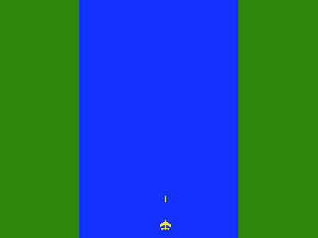

# River Raid
A recreation of River Raid, the Atari 2600 game, built for reinforcement learning, plus Covid Raid,
a spin-off made during the 2020 lockdown.



The trained agent (`models/hunter.pt`) hunts enemies across the river, refuels when it runs low,
shoots the fuel tanks it does not need and flies through the narrow channels. Over 32 test games
capped at 10 minutes it survived 7.4 minutes on average, 18 games reached the cap, and it shot 93%
of the enemies it met. It still crashes early now and then: 8 of the 32 games ended within 3 minutes.

The original 2020 version (TensorFlow DQN) is at commit
[`205464a`](../../tree/205464aa93dc3fdf930a48531ff765b1724ed4c0); its agent is in
[media/river_raid_ai_gameplay.gif](media/river_raid_ai_gameplay.gif).

## Installation
Python 3.10 or newer.
```
pip install -e ".[train,dev]"     # the game, training and tests
pip install -e .                  # only the game
```
On Linux `pip install torch` includes CUDA support. Check the GPU with
`python -c "import torch; print(torch.cuda.is_available())"`.

## Play
```
python play_river_raid.py    # River Raid
python covid_game.py         # Covid Raid
```
Arrows steer and change speed, space shoots, p pauses. You have 3 lives; fly over fuel tanks to
refuel and avoid the banks and the enemies.

## Watch the trained agent
```
python watch.py models/hunter.pt                       # 3 games in a window, each until it crashes
python watch.py models/hunter.pt --max-minutes 5       # end each game after 5 minutes
python watch.py models/hunter.pt --record media/agent.gif --episodes 1 --max-minutes 1
```
`--seed` picks another river, `--sound` turns the sound on. `watch.py` works with any checkpoint,
including your own `runs/<run>/best.pt`.

## Train an agent
```
FLAGS="--obs-style clean --survival-reward 0.0025 --reward-scale 0.02 --escape-penalty 0.5 --refuel-below 0.6 --low-fuel-shot-penalty 1.0 --bf16"
python pretrain.py $FLAGS --out runs/pretrain.pt
python train.py --init-from runs/pretrain.pt $FLAGS --num-workers 8 --run-name hunter
```
1. `pretrain.py` (a few minutes) records a scripted expert playing and trains the network to imitate it.
2. `train.py` improves that network with PPO for 50M agent steps, about 4 hours on an RTX 3090 with
   an 8-core CPU. `models/hunter.pt` is this recipe stopped after 37.7M steps.

Use the same options for both commands. Follow the run with `tensorboard --logdir runs`; the most
useful curves are `episode/minutes_survived`, `episode/kill_ratio` (about 0.9 when the agent hunts,
below 0.6 when it camps in the middle) and `episode/out_of_fuel`.

* `runs/<run>/latest.pt` is saved every 50 updates and when you stop the run (ctrl-c or `kill`);
  `runs/<run>/best.pt` is the checkpoint with the best 100-game average score.
* `python train.py --resume runs/<run>/latest.pt` continues a run. It keeps the checkpoint's reward,
  observation and network settings, whatever the command line says.
* `python train.py --init-from <checkpoint> <options>` starts a new run from existing weights.
* The game runs on the CPU (`--num-workers` processes), the network on the GPU. If the GPU is
  underused, raise `--num-envs` (default 64).

All options: `python train.py --help`.

## How it works
The agent sees the last 4 frames of the river as 96x96 grayscale images, with a fuel gauge in the
bottom rows, and picks one of 6 actions (no move, left, right, each with or without shooting) 7.5
times per second. A game ends when the plane crashes or runs out of fuel. In the AI version a full
tank lasts 1 minute, so the agent has to use some tanks and can shoot the rest.

`--obs-style clean` draws the agent's view as flat silhouettes on black water, without the houses
and trees: in plain grayscale the helicopters and ships are barely darker than the water.

The network is an IMPALA ResNet actor-critic (`river_raid/rl/network.py`, 1.3M parameters), trained
with PPO (`river_raid/rl/ppo.py`, in the style of [CleanRL](https://github.com/vwxyzjn/cleanrl)).
The reward in the recipe:

| | |
|---|---|
| shooting a helicopter / ship / fuel tank | +1.2 / +0.8 / +1.6 |
| an enemy that leaves the screen alive | -0.5 |
| staying alive | +0.0025 per frame |
| refuelling below 60% fuel | +0.15 per frame |
| shooting a fuel tank below 60% fuel | no points, -1 |
| reversing left/right within half a second | -0.05, against twitchy steering |
| crashing or running out of fuel | -2 |

### Why imitation first
PPO from scratch learns to sit in the middle of the river and shoot whatever crosses its path. It
never learns to go after enemies, even though a player that hunts earns three times more reward.
So the agent first imitates `river_raid/expert.py`, a scripted player that reads the game state,
aims ahead of enemies, refuels when low and checks its moves 40 frames ahead. The expert itself
survives only about 3 minutes, but starting from it, PPO learns to hunt and then outlasts its teacher.

After 3M training steps (measured before the channels got their ramps):

| | enemies killed | minutes survived |
|---|---|---|
| PPO from scratch, default reward | 55% | 0.99 |
| PPO from scratch, recipe reward and clean view, no fuel rules | 66% | 0.87 |
| imitation then PPO, recipe reward and clean view, no fuel rules | 87% | 1.31 |
| imitation then PPO, full recipe | 87% | 2.48 |

## Use the environment in your own code
```python
import gymnasium as gym
import river_raid   # registers RiverRaid-v1

env = gym.make('RiverRaid-v1', render_mode='human', obs_style='clean')
obs, info = env.reset(seed=0)
while True:
    obs, reward, terminated, truncated, info = env.step(env.action_space.sample())
    if terminated or truncated:
        break
print(info['score'], info['kills'])
```
Every reward term and game setting above is a constructor argument of `RiverRaidEnv`.

## What changed since 2020
* The game runs headless and much faster: the 2020 training ran it at 30 frames per second in a
  window, and cut every game off after about 20 seconds.
* PPO with imitation of a scripted expert, in PyTorch, instead of DQN in TensorFlow.
* The river ramps into its narrow channels, and enemies also appear inside them.
* Bug fixes, among them an un-fired bullet that could shoot enemies, and hitting an enemy and a bank in
  the same frame costing two lives.

## Project layout
```
river_raid/game/     the game: RiverRaid, CovidRaid, the river, entities
river_raid/env.py    Gymnasium environment
river_raid/expert.py scripted player, the teacher for pretrain.py
river_raid/rl/       PPO: vectorized environments, network, training loop
models/hunter.pt     the trained agent
pretrain.py, train.py, watch.py, play_river_raid.py, covid_game.py
tests/               run with pytest
```
